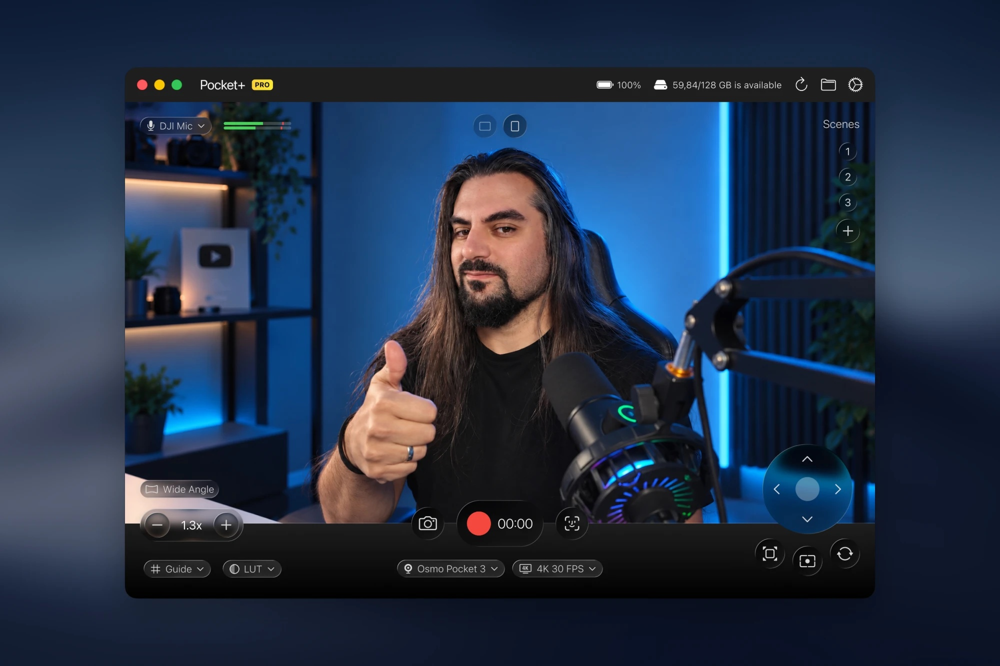

  

<h1 align="center">Pocket+</h1>

  A free macOS app that turns your <b>DJI Osmo Pocket 2, 3, 4 or 4P</b> into a controllable desk camera: 
  record, take photos, steer the gimbal, zoom and track faces — all from your Mac.

  <a href="../../releases/latest"><b>⬇︎ Download the latest version</b></a> &nbsp;·&nbsp; <a href="https://pocketplus.app/"><b>Website</b></a> &nbsp;·&nbsp; <a href="https://ferdicildiz.gumroad.com/l/pocketcontrol"><b>Get Pro</b></a>

  🙌 <b>Like it? <a href="https://www.reddit.com/r/osmopocket/s/lvCdD2MSma">Upvote the post on r/osmopocket</a></b> — it helps more Osmo Pocket owners find the app.

  

---

## Looking for DJI Mimo on a Mac?

DJI Mimo, DJI's companion app for the Osmo Pocket, is made for iPhone, iPad and Android. There's no Mac version of it.
Pocket+ is an independent Mac app for when the Pocket sits next to your Mac: live view, gimbal and zoom control over USB-C, face tracking and recording straight to the Mac.
Keep Mimo on your phone for firmware updates and editing. More in [Is there a DJI Mimo app for Mac?](https://pocketplus.app/blog/dji-mimo-mac/)

Pocket+ isn't affiliated with or endorsed by DJI.

## Features

| | Free | Pro |
|---|:---:|:---:|
| Live preview, recording (H.264 / HEVC) and photos | ✅ | ✅ |
| Recording up to 1080p | ✅ | ✅ |
| Recording above 1080p, up to **4K** |  | ✅ |
| Gimbal joystick, center, front/back | ✅ | ✅ |
| **Scenes** — save camera angles and zoom, jump back with ⌥1–9 |  | ✅ |
| Zoom buttons and keyboard shortcuts | ✅ | ✅ |
| Face tracking | ✅ | ✅ |
| **Auto framing** (headroom-aware, one click) |  | ✅ |
| **Vertical video (9:16)** — true vertical with the Pocket upright, or a sharp 1080×1920 crop from 4K |  | ✅ |
| Grid and horizon guides | ✅ | ✅ |
| **Vertical video guide (9:16)** |  | ✅ |
| **Color looks (LUT)** — built-in looks, your own `.cube` and PNG LUTs |  | ✅ |
| **Wide-angle lens correction** — straightens the DJI wide-angle lens |  | ✅ |
| **Return to last position** when the camera reconnects |  | ✅ |
| **Zoom and aim on the preview** — scroll to zoom, drag or swipe to move the gimbal |  | ✅ |
| DJI Mic auto-switch, audio meter, countdown, battery and disk info | ✅ | ✅ |

**[Get Pro on Gumroad](https://ferdicildiz.gumroad.com/l/pocketcontrol)** — a one-time purchase. Paste your license key in **Settings › Pro** to unlock it. One license activates Pro on one Mac.

## Requirements

- macOS 14 Sonoma or later (Apple Silicon or Intel)
- DJI Osmo Pocket 2, 3, 4 or 4P, connected with USB-C and set to **Webcam** mode on the camera

## Install

1. Download [`PocketPlus.zip`](https://github.com/FerdiCildiz/pocket-plus/releases/latest/download/PocketPlus.zip) and open it (Safari unzips it for you).
2. Drag **Pocket+** into **Applications**.
3. Open the app. Pocket+ is signed and notarized by Apple, so it opens like any other Mac app. If macOS asks whether you want to open an app downloaded from the internet, click **Open**.
4. Allow **Camera**, **Microphone** and **Bluetooth** when asked.

## Getting started

1. Turn on the Pocket, connect it with USB-C and choose **Webcam** on the camera's screen.
2. The image appears within a few seconds. If it doesn't, click the reconnect button at the top right
   or replug the cable and choose Webcam again.
3. Battery and recording status are read over Bluetooth; everything else works without it.

### Shortcuts

| | |
|---|---|
| Record / stop | ⌘R |
| Photo | ⇧⌘S |
| Save the current view as a scene (Pro) | ⌘S |
| Landscape / vertical video (Pro) | ⇧⌘V |
| Open the output folder | ⌘O |
| Face tracking | ⌘T |
| Auto framing (Pro) | ⌘⇧T |
| Zoom in / out / reset | ⌘+ / ⌘− / ⌘0 |
| Go to a saved scene (Pro) | ⌥1 … ⌥9 |
| Close a panel / cancel countdown | Esc |

## FAQ

**Face tracking turns itself off.** The camera's own ActiveTrack is on. Turn it off on the camera.

**Where are my recordings?** In your **Movies** folder by default. Change it in Settings › Output folder.

## Support the project

Pocket+ is free. If it's useful to you, the best way to help is to
**[upvote and comment on the Reddit post](https://www.reddit.com/r/osmopocket/s/lvCdD2MSma)** so other Osmo Pocket owners can find it.
A ⭐ on this repo helps too.

## Feedback

Found a bug or have an idea? [Open an issue](../../issues/new/choose) or leave a comment on the [Reddit post](https://www.reddit.com/r/osmopocket/s/lvCdD2MSma).

## Disclaimer

Pocket+ is an independent project and is not affiliated with, endorsed by or sponsored by DJI.
DJI, Osmo and Osmo Pocket are trademarks of SZ DJI Technology Co., Ltd.
