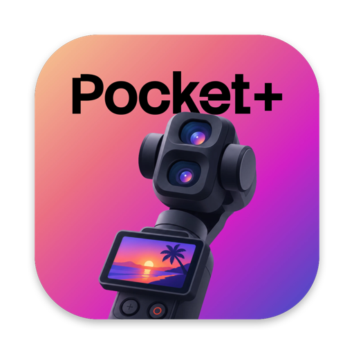
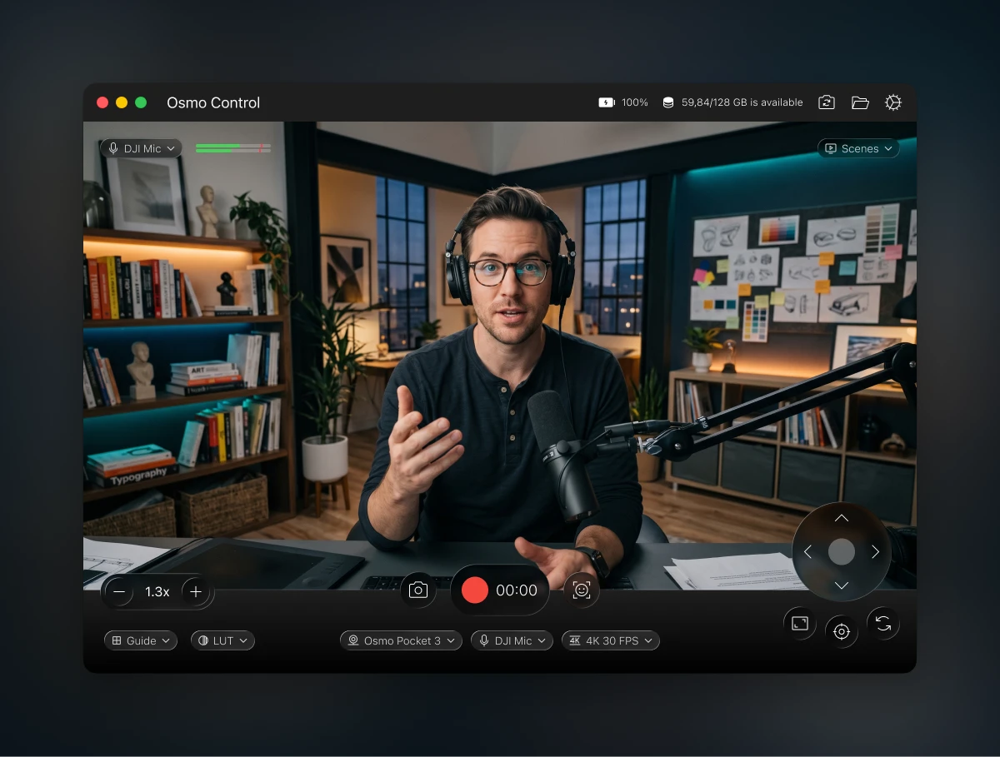

  

<h1 align="center">Pocket Control</h1>

  A free macOS app that turns your <b>DJI Osmo Pocket 3</b> into a controllable desk camera: 
  record, take photos, steer the gimbal, zoom and track faces — all from your Mac.

  <a href="../../releases/latest"><b>⬇︎ Download the latest version</b></a>

  

---

## Features

| | Free | Pro |
|---|:---:|:---:|
| Live preview, recording (H.264 / HEVC) and photos | ✅ | ✅ |
| Recording up to 1080p | ✅ | ✅ |
| Recording above 1080p, up to **4K** |  | ✅ |
| Gimbal joystick, center, front/back | ✅ | ✅ |
| **Scenes** — save camera angles and zoom, jump back with ⌥1–9 |  | ✅ |
| Zoom buttons and keyboard shortcuts | ✅ | ✅ |
| Face tracking | ✅ | ✅ |
| **Auto framing** (headroom-aware, one click) |  | ✅ |
| Grid and horizon guides | ✅ | ✅ |
| **Vertical video guide (9:16)** |  | ✅ |
| **Color looks (LUT)** — built-in looks, your own `.cube` and PNG LUTs |  | ✅ |
| **Zoom and aim on the preview** — scroll to zoom, drag or swipe to move the gimbal |  | ✅ |
| DJI Mic auto-switch, audio meter, countdown, battery and disk info | ✅ | ✅ |

Pro licenses will be available soon.

## Requirements

- macOS 14 Sonoma or later (Apple Silicon or Intel)
- DJI Osmo Pocket 3, connected with USB-C and set to **Webcam** mode on the camera

## Install

1. Download `PocketControl-x.y.dmg` from [Releases](../../releases/latest) and open it.
2. Drag **Pocket Control** into **Applications**.
3. Open the app. The app is free but not notarized by Apple, so macOS blocks it the first time:
   open **System Settings › Privacy & Security**, scroll down and click **Open Anyway**. You only do this once.
4. Allow **Camera**, **Microphone** and **Bluetooth** when asked.

## Getting started

1. Turn on the Pocket 3, connect it with USB-C and choose **Webcam** on the camera's screen.
2. The image appears within a few seconds. If it doesn't, click the reconnect button at the top right
   or replug the cable and choose Webcam again.
3. Battery and recording status are read over Bluetooth; everything else works without it.

### Shortcuts

| | |
|---|---|
| Record / stop | ⌘R |
| Photo | ⌘S |
| Open the output folder | ⌘O |
| Face tracking | ⌘T |
| Auto framing (Pro) | ⌘⇧T |
| Zoom in / out / reset | ⌘+ / ⌘− / ⌘0 |
| Go to a saved scene (Pro) | ⌥1 … ⌥9 |
| Close a panel / cancel countdown | Esc |

## FAQ

**Face tracking turns itself off.** The camera's own ActiveTrack is on. Turn it off on the camera.

**Where are my recordings?** In your **Movies** folder by default. Change it in Settings › Output folder.

**"Open Anyway" isn't there.** Try opening the app once more, then check Privacy & Security again.

## Feedback

Found a bug or have an idea? [Open an issue](../../issues/new/choose).

## Disclaimer

Pocket Control is an independent project and is not affiliated with, endorsed by or sponsored by DJI.
DJI, Osmo and Osmo Pocket are trademarks of SZ DJI Technology Co., Ltd.

---

## Türkçe

Pocket Control, **DJI Osmo Pocket 3**'ü Mac'ten yönetilen bir masa kamerasına çeviren ücretsiz bir macOS uygulamasıdır.

**Kurulum:** [Releases](../../releases/latest) sayfasından DMG'yi indirin, uygulamayı **Uygulamalar** klasörüne sürükleyin. İlk açılışta macOS engellerse **Sistem Ayarları › Gizlilik ve Güvenlik › Yine de Aç** deyin. Kamera, mikrofon ve Bluetooth izinlerine izin verin.

**Bağlantı:** Pocket 3'ü USB-C ile bağlayın ve kameranın ekranında **Webcam** modunu seçin.

**Pro:** 4K kayıt, LUT'lar, 9:16 kılavuzu, oto kadraj, sahneler ve önizleme üstünden zoom/gimbal kontrolü. Pro lisansları yakında satışta olacak.
